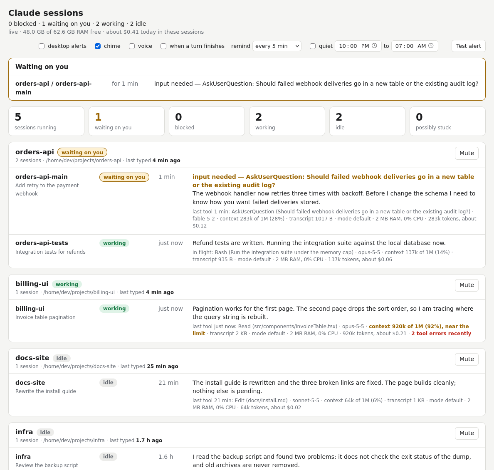

# Claude Code Task Monitor

`ccmon` shows every [Claude Code](https://claude.com/claude-code) session
running on your machine on one page: what each is doing, how full its context
is, and above all **which ones are waiting on you**.

If you run several sessions at once, one of them is usually sitting on a
permission prompt or a question while you look at another. `ccmon` puts those
at the top and can alert you with a sound, a spoken message or a desktop
notification.



It is a single program with no runtime to install. It runs on Linux, macOS
and Windows, reads Claude Code's files without ever writing to them, and
sends nothing off your machine.

> This is an independent project. It is not made or supported by Anthropic.

## Status

Early. It was developed and run on Linux against Claude Code 2.1.330. The
macOS and Windows builds compile but have not yet been run on those systems;
reports are welcome.

## Install

You need [Go](https://go.dev/dl/) 1.26 or later.

```sh
git clone https://github.com/blakemcbride/ClaudeCodeTaskMonitor.git
cd ClaudeCodeTaskMonitor
make build        # or: go build -o ccmon .
```

`make dist` builds all five platform binaries from whichever system you are
on. No C compiler is needed.

## Use

```sh
./ccmon
```

This starts a server on `http://127.0.0.1:7433/` and opens it in your
browser. Leave the tab open; it updates by itself within a second or two of a
session changing state. Stop it with Ctrl-C.

To leave it running in the background, start it with `./ccmon &`. It keeps
running after you close that terminal; stop it with `kill` and the process id
it printed, or `pkill ccmon`.

For a terminal, or over SSH:

```sh
./ccmon -once          # print the current state and exit
./ccmon -once -json    # the same as JSON, for scripts
```

| Flag | Meaning |
|---|---|
| `-port N` | Port to listen on. Default 7433. |
| `-once` | Print the current state and exit. |
| `-json` | With `-once`, print JSON. |
| `-private` | Hide reply text until you click "Show". Useful when sharing your screen. |
| `-no-open` | Do not open the browser. |
| `-no-cost` | Do not show cost estimates. |
| `-claude-dir DIR` | Claude Code's config directory. Default `$CLAUDE_CONFIG_DIR`, else `~/.claude`. |
| `-config FILE` | Settings file. See below. |

## What it shows

A panel at the top shows the machine's memory: how much is free, how much the
Claude sessions are using (including the programs they started) against
everything else, and swap. It turns amber when less than 15% is free and red
below 7%.

Sessions are grouped by working directory. Each project shows its path, when
you last typed in it, and its git or Subversion state. Each session shows:

- **State**, and how long it has been in it:
  - **waiting on you**: stopped on a permission prompt, a question or a
    dialog. Nothing happens until you answer. The page shows what is being
    asked.
  - **blocked**: cannot continue for an outside reason.
  - **working**
  - **idle**: finished its turn; your move.
- The latest reply (click to expand) and the last tool call, or the one in
  flight.
- Model, context used and how close it is to the limit, transcript size and
  permission mode.
- Memory and CPU of the session and everything it started.
- Tokens used and an estimated cost.
- Recent tool errors, and a **stuck?** flag when a session has been working
  with no activity for 15 minutes or keeps failing the same tool call.

Highlighted: context over 85%, tool errors, stuck sessions, and sessions
running with permission prompts bypassed.

## Alerts

The controls at the top of the page turn on a chime, a spoken message and
desktop notifications. They fire when a session starts waiting on you,
becomes blocked, nears its context limit or looks stuck, and when the
machine's free RAM falls below 15% and again below 7%.

- **remind** repeats the alert while a session is still waiting.
- **when a turn finishes** also alerts when a session goes idle after working
  for more than a minute.
- **quiet** silences alerts during the hours you choose.
- **Mute** on a project silences that project.

The number of waiting sessions also appears in the browser tab's title and
icon.

Alerts come from the browser, so the page must be open in a tab. The browser
asks once for permission to show notifications, and plays no sound until you
have clicked the page once. Alert settings are stored in that browser.

## Settings file

Optional. The default location is `ccmon/config.json` in your user config
directory (`~/.config` on Linux, `~/Library/Application Support` on macOS,
`%AppData%` on Windows). Every key is optional.

```json
{
  "port": 7433,
  "private": false,
  "showCost": true,
  "stuckMinutes": 15,
  "contextWarnPercent": 85,
  "models": {
    "claude-opus-5-5": {
      "input": 4, "cacheWrite5m": 5, "cacheWrite1h": 8,
      "cacheRead": 0.2, "output": 20, "context": 1000000
    }
  }
}
```

`models` adds to or replaces the built-in table. A key matches any model id
that starts with it. Prices are US dollars per million tokens.

## What to know about the numbers

- **Context limit.** The transcript records how many tokens are in use but
  not the size of the window. The percentage uses the window size Anthropic
  publishes for the model. If your sessions run with a different limit, set
  `context` for that model in the settings file.
- **Cost is an estimate.** It multiplies the token counts in the transcript
  by a built-in price table that will go out of date. It does not include
  subagents, and on a subscription plan you do not pay per token at all. Use
  `-no-cost` to hide it.
- **Stuck is a hint.** A long build or test run also looks like silence.
- **Subversion.** Only the working copy is read; the server is not contacted,
  so the page cannot tell you whether you are out of date. Unversioned files
  are not counted as uncommitted.

## Privacy and safety

- Read-only. `ccmon` never writes to Claude Code's directory, and runs git
  and Subversion in ways that do not modify the working copy.
- Local only. The server listens on `127.0.0.1`, accepts only `GET`, and
  rejects requests whose `Host` or `Origin` is not its own, so another web
  page in your browser cannot read your session text through it.
- Nothing is sent anywhere. There is no telemetry and no network use beyond
  the loopback page.

Anyone who can use your account on the machine can open the page, exactly as
they could read the transcript files directly.

## How it works

Claude Code keeps a small file per running session in
`~/.claude/sessions/` with its process id, working directory and status, and
appends each session's conversation to a transcript under
`~/.claude/projects/`. `ccmon` re-reads the session files every second and
reads only what has been appended to each transcript, so transcripts of
several hundred megabytes cost almost nothing to follow.

These files are **not a documented interface**. They can change in any Claude
Code release. `ccmon` treats every field as optional and shows a blank rather
than failing, but a release may still break something. Please open an issue
with your Claude Code version if it does.

[PLAN.md](PLAN.md) has the design notes and what is planned next.

## Development

```sh
make test
```

Test fixtures are made up. Please do not add real transcripts to the
repository; they contain private text.

## License

[MIT](LICENSE)
